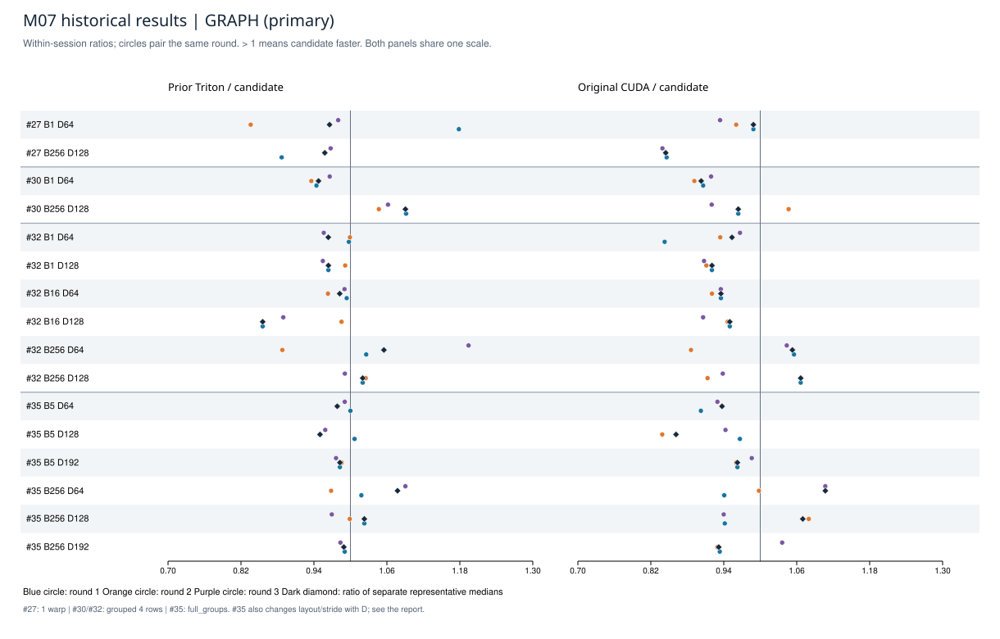
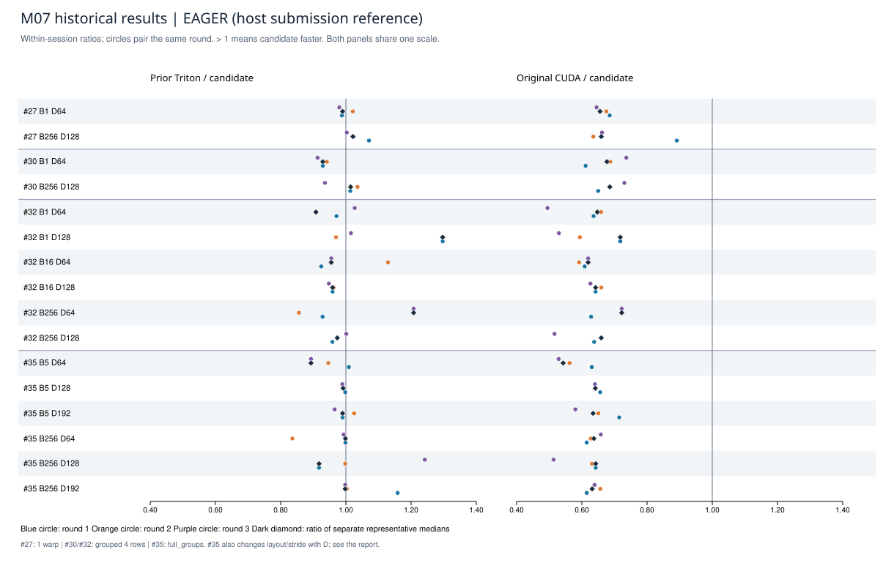

# M07 历史性能结果：四次会话分别复算

数据截止2026-10-10；本报告于2026-10-14由教练脚本从已归档原始样本重新生成。没有新增GPU运行。

三条优化路线均未在记录范围内证实相对原版CUDA的稳定收益。规模更大并不自动意味着grouped更快；正确性、静态编译变化和性能收益分别判断。

## 统一读法

所有比值只除同一次会话、同一配置、同一政策的耗时。27/30/32/35互不合并；30与32虽然使用同一grouped源码，仍保留为两次独立会话。Graph是主结果，Eager单列，后者包含不同的主机提交路径。

- 每个样本是100次调用的CUDA Event区间耗时÷100；每臂/政策/进程30个区间均值。
- 进程中位数：该进程30个区间均值的中位数。每配置3个新进程。
- 代表耗时：3个进程中位数的中位数。代表比＝参考臂代表耗时÷候选代表耗时。
- 逐轮配对比：同轮参考进程中位数÷候选进程中位数；配对中位比是这3个比值的中位数。它通常不等于代表比。
- 比值>1表示候选更快；候选代表耗时变化＝(1/代表比−1)×100%。不能把speedup−1当作耗时降幅。
- 胜/平/负按未四舍五入的逐轮比与1比较。3/3同向只描述该会话，不能视为统计显著性或普遍保证。

这些是重复同一批地址、三臂共享buffer、无cache flush的NVIDIA FP16微基准。分配、公开索引校验、首次JIT、预热、检查和存档不计时。Triton使用预验证raw launch；Graph包含100次调用，Eager分别走各自提交入口。不能由此推出模型吞吐、请求P99、实际DRAM带宽、硬件计数器或AMD结果。

每worker的历史记录声明190次全backing检查，但只保存7个完整after阶段；本次只复核计时JSON、来源哈希、启动元数据和统计，不重复声称离线验证了190份数组。原始正确性数组核验见各会话既有review。

## 配置与来源

| 会话 | 同场三臂 | 配置 | 进程/区间均值 | 原始数据与原审查 |
| --- | --- | --- | ---: | --- |
| 27：单行 4→1 warp | original_cuda / frozen_v1 / candidate | B1/D64、B256/D128；C1024 | 6 / 1080 | [原始run](../../logs/m07-warps-timing-results/run-20261010-121112-p7ip91zk/status.json) · [review](../../reviews/20261010-m07-warps-timing-review.md) |
| 30：4行分组：两配置探索 | original_cuda / frozen_v1 / grouped | B1/D64、B256/D128；C1024 | 6 / 1080 | [原始run](../../logs/m07-grouped-timing-results/run-20261010-131625-od4rcwyb/status.json) · [review](../../reviews/20261010-m07-grouped-timing-review.md) |
| 32：4行分组：六配置回归 | original_cuda / frozen_v1 / grouped | B1/16/256 × D64/128；C1024 | 18 / 3240 | [原始run](../../logs/m07-grouped-six-timing-results/run-20261010-134931-4l7bljlh/status.json) · [review](../../reviews/20261010-m07-grouped-six-timing-review.md) |
| 35：满组 constexpr 分支 | original_cuda / accepted_grouped / full_groups | B5/256 × 三种布局/行距；C512 | 18 / 3240 | [原始run](../../logs/m07-full-groups-timing-results/run-20261010-215026-gs6vimx3/status.json) · [review](../../reviews/20261010-m07-full-groups-timing-review.md) |

27/30/32：交错缓存、gap0、guard0、int32索引0..B−1、seed20261004。35：seed20261011、唯一索引(37i+11)%512；D64为interleaved/gap0/guard0，D128为separate/gap64/guard0，D192为separate/gap64/guard64；源/目标行距分别64/128、192/128、256/256。因此35不同D之间也改变了布局/行距，不能解释为纯宽度效应。

27候选是1warp/1行，参考v1是4warp/1行；30/32候选是4warp/4行，参考仍为v1；35两条Triton均4warp/4行，只比较满组constexpr条件分支。35的B5属于尾组对照；不能把其波动归因于满组分支加速。

共同环境：RTX 4070 Ti，Torch 2.9.1+cu128、CUDA 12.8、Triton 3.5.1；上游commit `9a91cfafe754aa85daee49998176275667eb58f2`。各进程真实环境、测量次序、启动参数、前后telemetry与完整raw样本均保留在[明细JSON](historical-results.json)。

## GRAPH：主结果



[独立PDF](figures/graph-ratios.pdf) · [绝对耗时图](figures/graph-latency.svg) · [绝对耗时PDF](figures/graph-latency.pdf)

图中的三个彩色圆点是逐轮配对比，深色菱形是代表比。表内单位为µs/次；“旧Triton”指本会话参考臂。

| 会话/配置 | 原版 | 旧Triton | 候选 | 旧/候选代表比 | 原版/候选代表比 | 候选相对旧臂耗时变化 |
| --- | ---: | ---: | ---: | ---: | ---: | ---: |
| 27 · B1/D64 | 0.981440 | 0.958560 | 0.992640 | 0.965667 | 0.988717 | +3.555% |
| 27 · B256/D128 | 1.009440 | 1.144960 | 1.195360 | 0.957837 | 0.844465 | +4.402% |
| 30 · B1/D64 | 1.089600 | 1.143520 | 1.206880 | 0.947501 | 0.902824 | +5.541% |
| 30 · B256/D128 | 1.041120 | 1.177920 | 1.080160 | 1.090505 | 0.963857 | -8.299% |
| 32 · B1/D64 | 1.132000 | 1.144000 | 1.187200 | 0.963612 | 0.953504 | +3.776% |
| 32 · B1/D128 | 1.199200 | 1.255520 | 1.302720 | 0.963768 | 0.920535 | +3.759% |
| 32 · B16/D64 | 1.103360 | 1.158880 | 1.179680 | 0.982368 | 0.935304 | +1.795% |
| 32 · B16/D128 | 1.095040 | 0.986400 | 1.152800 | 0.855656 | 0.949896 | +16.869% |
| 32 · B256/D64 | 1.173600 | 1.176160 | 1.114720 | 1.055117 | 1.052820 | -5.224% |
| 32 · B256/D128 | 1.173760 | 1.122720 | 1.100480 | 1.020209 | 1.066589 | -1.981% |
| 35 · B5/D64 | 1.093920 | 1.142080 | 1.167360 | 0.978344 | 0.937089 | +2.214% |
| 35 · B5/D128 | 0.984160 | 1.085280 | 1.142400 | 0.950000 | 0.861485 | +5.263% |
| 35 · B5/D192 | 1.132480 | 1.156320 | 1.176640 | 0.982731 | 0.962469 | +1.757% |
| 35 · B256/D64 | 1.163360 | 1.132320 | 1.050880 | 1.077497 | 1.107034 | -7.192% |
| 35 · B256/D128 | 1.150560 | 1.100000 | 1.075360 | 1.022913 | 1.069930 | -2.240% |
| 35 · B256/D192 | 1.017760 | 1.080480 | 1.092320 | 0.989161 | 0.931742 | +1.096% |

| 会话/配置 | 参考臂 | 第1轮比 | 第2轮比 | 第3轮比 | 配对中位比 | 胜/平/负 |
| --- | --- | ---: | ---: | ---: | ---: | ---: |
| 27 · B1/D64 | frozen_v1 | 1.178433 | 0.835953 | 0.979882 | 0.979882 | 1/0/2 |
| 27 · B1/D64 | original_cuda | 0.988717 | 0.960427 | 0.933922 | 0.960427 | 0/0/3 |
| 27 · B256/D128 | frozen_v1 | 0.886911 | 0.957837 | 0.967463 | 0.957837 | 0/0/3 |
| 27 · B256/D128 | original_cuda | 0.846009 | 0.844465 | 0.839099 | 0.844465 | 0/0/3 |
| 30 · B1/D64 | frozen_v1 | 0.944153 | 0.935716 | 0.965929 | 0.944153 | 0/0/3 |
| 30 · B1/D64 | original_cuda | 0.906126 | 0.891595 | 0.919130 | 0.906126 | 0/0/3 |
| 30 · B256/D128 | frozen_v1 | 1.091542 | 1.046779 | 1.061851 | 1.061851 | 3/0/0 |
| 30 · B256/D128 | original_cuda | 0.963857 | 1.046637 | 0.920090 | 0.963857 | 1/0/2 |
| 32 · B1/D64 | frozen_v1 | 0.997489 | 0.999208 | 0.956199 | 0.997489 | 0/0/3 |
| 32 · B1/D64 | original_cuda | 0.842773 | 0.934240 | 0.966712 | 0.934240 | 0/0/3 |
| 32 · B1/D128 | frozen_v1 | 0.963768 | 0.991415 | 0.954686 | 0.963768 | 0/0/3 |
| 32 · B1/D128 | original_cuda | 0.920535 | 0.911372 | 0.907588 | 0.911372 | 0/0/3 |
| 32 · B16/D64 | frozen_v1 | 0.993897 | 0.963037 | 0.990281 | 0.990281 | 0/0/3 |
| 32 · B16/D64 | original_cuda | 0.935304 | 0.920622 | 0.935113 | 0.935113 | 0/0/3 |
| 32 · B16/D128 | frozen_v1 | 0.855656 | 0.985438 | 0.889599 | 0.889599 | 0/0/3 |
| 32 · B16/D128 | original_cuda | 0.949896 | 0.946380 | 0.906014 | 0.946380 | 0/0/3 |
| 32 · B256/D64 | frozen_v1 | 1.025980 | 0.888016 | 1.194361 | 1.025980 | 2/0/1 |
| 32 · B256/D64 | original_cuda | 1.055548 | 0.886084 | 1.043641 | 1.043641 | 2/0/1 |
| 32 · B256/D128 | frozen_v1 | 1.020209 | 1.025146 | 0.990878 | 1.020209 | 2/0/1 |
| 32 · B256/D128 | original_cuda | 1.066589 | 0.913304 | 0.938370 | 0.938370 | 1/0/2 |
| 35 · B5/D64 | accepted_grouped | 1.000000 | 0.978344 | 0.990706 | 0.990706 | 0/1/2 |
| 35 · B5/D64 | original_cuda | 0.902349 | 0.937089 | 0.929553 | 0.929553 | 0/0/3 |
| 35 · B5/D128 | accepted_grouped | 1.006805 | 0.950000 | 0.958614 | 0.958614 | 1/0/2 |
| 35 · B5/D128 | original_cuda | 0.966532 | 0.838796 | 0.942826 | 0.942826 | 0/0/3 |
| 35 · B5/D192 | accepted_grouped | 0.982731 | 0.985692 | 0.976364 | 0.982731 | 0/0/3 |
| 35 · B5/D192 | original_cuda | 0.962469 | 0.960399 | 0.986058 | 0.962469 | 0/0/3 |
| 35 · B256/D64 | accepted_grouped | 1.018035 | 0.968258 | 1.090438 | 1.018035 | 2/0/1 |
| 35 · B256/D64 | original_cuda | 0.940765 | 0.997811 | 1.107034 | 0.997811 | 1/0/2 |
| 35 · B256/D128 | accepted_grouped | 1.022913 | 0.998949 | 0.969389 | 0.998949 | 1/0/2 |
| 35 · B256/D128 | original_cuda | 0.941675 | 1.079892 | 0.939921 | 0.941675 | 1/0/2 |
| 35 · B256/D192 | accepted_grouped | 0.990609 | 0.989161 | 0.983576 | 0.989161 | 0/0/3 |
| 35 · B256/D192 | original_cuda | 0.933382 | 0.929398 | 1.036047 | 0.933382 | 1/0/2 |

## EAGER：主机提交参考



[独立PDF](figures/eager-ratios.pdf) · [绝对耗时图](figures/eager-latency.svg) · [绝对耗时PDF](figures/eager-latency.pdf)

图中的三个彩色圆点是逐轮配对比，深色菱形是代表比。表内单位为µs/次；“旧Triton”指本会话参考臂。

| 会话/配置 | 原版 | 旧Triton | 候选 | 旧/候选代表比 | 原版/候选代表比 | 候选相对旧臂耗时变化 |
| --- | ---: | ---: | ---: | ---: | ---: | ---: |
| 27 · B1/D64 | 8.567840 | 12.934720 | 13.065920 | 0.989959 | 0.655739 | +1.014% |
| 27 · B256/D128 | 8.350880 | 12.935840 | 12.660480 | 1.021750 | 0.659602 | -2.129% |
| 30 · B1/D64 | 9.261120 | 12.711360 | 13.678720 | 0.929280 | 0.677046 | +7.610% |
| 30 · B256/D128 | 9.527840 | 14.095200 | 13.894080 | 1.014475 | 0.685748 | -1.427% |
| 32 · B1/D64 | 9.360960 | 13.131840 | 14.459680 | 0.908169 | 0.647384 | +10.112% |
| 32 · B1/D128 | 20.373280 | 36.803839 | 28.379040 | 1.296867 | 0.717899 | -22.891% |
| 32 · B16/D64 | 9.774720 | 15.073280 | 15.781440 | 0.955127 | 0.619381 | +4.698% |
| 32 · B16/D128 | 8.688640 | 12.979040 | 13.529760 | 0.959296 | 0.642187 | +4.243% |
| 32 · B256/D64 | 11.304480 | 18.902081 | 15.651520 | 1.207683 | 0.722261 | -17.197% |
| 32 · B256/D128 | 9.622080 | 14.202560 | 14.589120 | 0.973504 | 0.659538 | +2.722% |
| 35 · B5/D64 | 8.597280 | 14.146560 | 15.841120 | 0.893028 | 0.542719 | +11.979% |
| 35 · B5/D128 | 8.637760 | 13.353120 | 13.466400 | 0.991588 | 0.641431 | +0.848% |
| 35 · B5/D192 | 9.005280 | 14.052160 | 14.195040 | 0.989935 | 0.634396 | +1.017% |
| 35 · B256/D64 | 8.733760 | 13.691360 | 13.710400 | 0.998611 | 0.637017 | +0.139% |
| 35 · B256/D128 | 9.726400 | 13.891680 | 15.136000 | 0.917791 | 0.642600 | +8.957% |
| 35 · B256/D192 | 8.652640 | 13.669600 | 13.700160 | 0.997769 | 0.631572 | +0.224% |

| 会话/配置 | 参考臂 | 第1轮比 | 第2轮比 | 第3轮比 | 配对中位比 | 胜/平/负 |
| --- | --- | ---: | ---: | ---: | ---: | ---: |
| 27 · B1/D64 | frozen_v1 | 0.987999 | 1.021043 | 0.979819 | 0.987999 | 1/0/2 |
| 27 · B1/D64 | original_cuda | 0.685447 | 0.675143 | 0.645208 | 0.675143 | 0/0/3 |
| 27 · B256/D128 | frozen_v1 | 1.070820 | 1.021750 | 1.002738 | 1.021750 | 3/0/0 |
| 27 · B256/D128 | original_cuda | 0.891313 | 0.635363 | 0.661718 | 0.661718 | 0/0/3 |
| 30 · B1/D64 | frozen_v1 | 0.929280 | 0.941709 | 0.913170 | 0.929280 | 0/0/3 |
| 30 · B1/D64 | original_cuda | 0.611519 | 0.687174 | 0.736467 | 0.687174 | 0/0/3 |
| 30 · B256/D128 | frozen_v1 | 1.013565 | 1.035859 | 0.935904 | 1.013565 | 2/0/1 |
| 30 · B256/D128 | original_cuda | 0.650156 | 0.686610 | 0.730372 | 0.686610 | 0/0/3 |
| 32 · B1/D64 | frozen_v1 | 0.971167 | 0.908169 | 1.027081 | 0.971167 | 1/0/2 |
| 32 · B1/D64 | original_cuda | 0.635966 | 0.659069 | 0.494669 | 0.635966 | 0/0/3 |
| 32 · B1/D128 | frozen_v1 | 1.296867 | 0.969687 | 1.015578 | 1.015578 | 2/0/1 |
| 32 · B1/D128 | original_cuda | 0.717899 | 0.593979 | 0.529793 | 0.593979 | 0/0/3 |
| 32 · B16/D64 | frozen_v1 | 0.924452 | 1.129144 | 0.955127 | 0.955127 | 1/0/2 |
| 32 · B16/D64 | original_cuda | 0.608735 | 0.591544 | 0.619381 | 0.608735 | 0/0/3 |
| 32 · B16/D128 | frozen_v1 | 0.959296 | 0.962745 | 0.947925 | 0.959296 | 0/0/3 |
| 32 · B16/D128 | original_cuda | 0.642187 | 0.659456 | 0.626359 | 0.642187 | 0/0/3 |
| 32 · B256/D64 | frozen_v1 | 0.928489 | 0.855953 | 1.207683 | 0.928489 | 1/0/2 |
| 32 · B256/D64 | original_cuda | 0.628461 | 0.721965 | 0.722261 | 0.721965 | 0/0/3 |
| 32 · B256/D128 | frozen_v1 | 0.958852 | 0.973504 | 1.001244 | 0.973504 | 1/0/2 |
| 32 · B256/D128 | original_cuda | 0.637656 | 0.659538 | 0.516206 | 0.637656 | 0/0/3 |
| 35 · B5/D64 | accepted_grouped | 1.009236 | 0.946075 | 0.893028 | 0.946075 | 1/0/2 |
| 35 · B5/D64 | original_cuda | 0.630588 | 0.562478 | 0.528973 | 0.562478 | 0/0/3 |
| 35 · B5/D128 | accepted_grouped | 0.998177 | 0.992531 | 0.989366 | 0.992531 | 0/0/3 |
| 35 · B5/D128 | original_cuda | 0.656268 | 0.642041 | 0.640183 | 0.642041 | 0/0/3 |
| 35 · B5/D192 | accepted_grouped | 0.989935 | 1.025426 | 0.965603 | 0.989935 | 1/0/2 |
| 35 · B5/D192 | original_cuda | 0.714627 | 0.650444 | 0.580153 | 0.650444 | 0/0/3 |
| 35 · B256/D64 | accepted_grouped | 0.998611 | 0.835984 | 0.993006 | 0.993006 | 0/0/3 |
| 35 · B256/D64 | original_cuda | 0.615089 | 0.627677 | 0.658273 | 0.627677 | 0/0/3 |
| 35 · B256/D128 | accepted_grouped | 0.917791 | 0.997844 | 1.241892 | 0.997844 | 1/0/2 |
| 35 · B256/D128 | original_cuda | 0.642600 | 0.631086 | 0.513435 | 0.631086 | 0/0/3 |
| 35 · B256/D192 | accepted_grouped | 1.158801 | 1.002878 | 0.997769 | 1.002878 | 2/0/1 |
| 35 · B256/D192 | original_cuda | 0.615128 | 0.656601 | 0.639093 | 0.639093 | 0/0/3 |

## 保留负结果与复习重点

27的1warp候选在两配置的Graph均未稳定获益。30的B256/D128相对v1三轮同向更快，但同场对原版仅1/3轮获胜。32相同grouped源码的六配置测试中，B1/B16均慢于两条参考臂，B256有涨有跌。35满组分支的B256三个宽度仍没有相对旧grouped的3/3同向收益；尾组对照也有波动。四次会话所有Eager轮次的候选均慢于原版。

32 · B256/D128是统计反例：Graph原版/候选代表比1.066589，看起来候选更快；但逐轮比为1.066589、0.913304、0.938370，配对中位比0.938370，只有1/3轮获胜。代表比、逐轮方向必须同时看。

编译观察曾看到满组分支改变静态寄存器记录/行判断，但这些不是运行时硬件计数器，也不能单凭它们解释性能。需要新的对照时创建新run，写明待验证假设，再以该run同场数据判断。

## 帮助与归因

用户实际执行GPU实验。27的NUM_WARPS修改由用户完成；grouped的行号、mask、grid三式经教练示范后由用户应用并运行；full_groups分支结构由教练准备，用户完成被接受的constexpr条件。计时入口、归档、独立检查与本汇编图表由教练辅助。工程结果不等于独立掌握，不因此新增口试/独立优化信用。

每次run原始`ownership`原文保存在明细JSON的`ownership_as_recorded`；报告保留全部负结果。

## 重生成与追加

从项目根目录运行（只读原始档案；输出限定本模块目录）：

```powershell
& 'C:/Users/Administrator/.cache/codex-runtimes/codex-primary-runtime/dependencies/python/python.exe' -B outputs/kv-cache-performance/modules/M07/generate-historical-results.py --self-test
```

统计/校验使用Python标准库，SVG/PDF使用现有ReportLab，无需Torch/Triton。可用`--data-only`只生成JSON/Markdown；`--out`可指定新的输出目录以比较重生成结果；可选`--png-node`传现有Node路径，通过相邻node_modules里的sharp生成PNG。

新增实验时在生成器的`SESSIONS`新增一项，保留旧run、source pin与独立session id；若合同改变，新增相应配置验证，不能静默套用旧范围。先验证新run完整，再增补图表，始终按session分组。

本次CPU复算：4会话、16个会话内配置、48个worker、8640个区间均值；204个归档源码条目哈希通过；所有已存代表值/逐轮比/耗时变化与原始样本复算一致。这里只统计归档记录，不代表新增GPU工作。

[生成器](generate-historical-results.py) · [CPU自检报告](historical-validation.json) · [产物哈希](historical-artifact-manifest.json)
