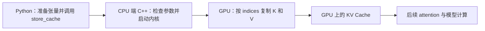

# 2026-09-30｜CUDA 学习日志：从线程分工到第一条正确性检查

> [!summary] 今天的位置
> 目前处于第 1 周的「原版源码理解与正确性验证」阶段。
> 今天完成了真实 GPU 写入的观察、第一条 K 整行检查，以及一次故意选错行的反例实验。尚未开始正式 benchmark，也没有编写个人 CUDA 优化内核。

记录依据：今天的对话、实际执行的代码快照、保存的控制台日志。学习用时未记录，不估算。本文件是本次汇总时的日记快照；复制进 Obsidian 后，不会自动与工作区日志同步。

## 1. 总进度与本周进度

| 范围 | 当前进度 | 口径 |
| --- | --- | --- |
| GitHub 作品整体 | **10 / 100，约 10%** | 已完整验收开发环境和原版测试；正确性工作已有中间成果 |
| 第 1 周：09-29～10-05 | **10 / 30，约 33%** | 剩余目标是数据布局/调用链、独立正确性、正式基线与首次 KV profiling |
| 第③层：CUDA 编程 | **1 项完成、2 项进行中、2 项未开始** | 见下表；五项工作量不同，不换算成知识掌握百分比 |
| 今天的新增证据 | **一个正确配对通过，一个错误配对按预期失败** | 检查范围目前只涉及第一条 K |

这些分数沿用既定交付清单。今天的成果属于尚未完整验收的正确性测试项目，所以总分还没有增加；不表示今天没有进步，也不表示已经掌握了全部 CUDA 的 10%。

### 第③层的五个验收项目

| 项目 | 状态 | 证据或剩余内容 |
| --- | --- | --- |
| 在 GPU 上运行原版内核 | ✅ 完成 | 原版测试已通过，今天又执行了真实 store 观察和检查 |
| 独立解释源码 | 🟡 进行中 | 已有分组、行内偏移等理解；完整地址与边界推导仍待独立验证 |
| 独立编写正确性检查 | 🟡 进行中 | 第一条 K 的正反例已运行；第二条 K、V、未命中行、边界仍待补齐 |
| 可信计时与性能解释 | ⬜ 未开始正式测量 | 没有 KV 微基准、重复基线或 KV profiler 结论 |
| 实现并验证个人 CUDA 变体 | ⬜ 未开始 | 后续根据基线和瓶颈假设设计，不预先假定某种分工更快 |

### 整体交付清单

| 交付项 | 8 | 8 | 已完成，包含前一天的成果 |
| 原版 KV 测试运行 | 权重 | 已验收 | 当前状态 |
| --- | ---: | ---: | --- |
| 固定版本、GPU 与开发环境 | 2 | 2 | 已完成，包含前一天的成果 |
| 数据契约、布局与调用链 | 5 | 0 | 正在学习，独立解释未整体验收 |
| 独立正确性测试 | 5 | 0 | 今天已有第一条 K 的正反例 |
| 正式微基准、基线与首次 KV profiling | 10 | 0 | 尚未完成 |
| 个人 CUDA 变体及验证 | 25 | 0 | 尚未开始 |
| 复测、消融、收益与回退分析 | 25 | 0 | 尚未开始 |
| Qwen3-0.6B 整机验证 | 10 | 0 | 保留到后期 |
| GitHub 成品与 30 分钟讲解 | 10 | 0 | 尚未完成；这份学习笔记不等于成品报告 |
| **合计** | **100** | **10** | |

### 四周安排

| 周次 | 日期 | 主要产出 | 当前周内进度 |
| --- | --- | --- | --- |
| 第 1 周 | 09-29～10-05 | 正确性、原版微基准、首次 KV trace | 10/30，进行中 |
| 第 2 周 | 10-06～10-12 | 自己实现一个有证据动机的 CUDA 变体 | 0/25，未开始 |
| 第 3 周 | 10-13～10-19 | 重复测量、消融、收益和回退分析 | 0/25，未开始 |
| 第 4 周 | 10-20～10-24 | 整机验证、README、报告、30 分钟讲解 | 0/20，未开始 |

目标为 **10 月 24 日完成作品，10 月 25 日演示与补漏**。每周计划投入 20 小时以上；实际投入尚未记录。当前分数不能用来线性预测剩余时间，也不能据此保证截止日期一定达到。

## 2. 我们究竟在优化什么

当前研究的是 mini-sglang 的 **KV Cache 写入路径**：把已经生成的 K、V 数值，按照 `indices` 指定的目标行，写入 GPU 上的缓存，供后续 attention 使用。

这里的 K、V 都是数值张量。背景上，K 参与与 Q 的匹配，V 提供被加权汇总的内容；当前 store 内核负责保存这些数值，不负责计算 attention 权重或生成回复文字。



当前 Python 代码用于准备实验和检查结果，实际数据搬运由已有的 CUDA C++ 内核完成。今天还没有实现新的 CUDA 内核。

源码定位：

| 文件（相对仓库根目录） | 作用 |
| --- | --- |
| `python/minisgl/kernel/store.py` | Python 入口、JIT 模块加载和调用 |
| `python/minisgl/kernel/csrc/jit/store.cu` | 启动逻辑、warp 到输入行的映射、复制 K/V |
| `warp.cuh` | warp 内每个线程具体搬哪些字节 |
| `python/minisgl/kvcache/mha_pool.py` | 后续需要追踪的真实 KV Cache 调用与布局 |
| `tests/kernel/test_store.py` | 上游测试，已运行通过，但覆盖仍需扩展 |

固定实验提交：`9a91cfafe754aa85daee49998176275667eb58f2`。这是实验使用的版本，不声称它永远等于上游最新 main。

## 3. 今天的真实数据：输入行与缓存行

观察脚本采用：

```text
缓存容量：8 个槽位
本次输入：2 行 K、2 行 V
每行：128 个 FP16 数值，每个数 2 字节
indices = [5, 1]
缓存初始值：全部为 -1
```

对应关系是：

| 输入编号 | K 的目标 | V 的目标 |
| --- | --- | --- |
| 0 | K cache 第 5 行 | V cache 第 5 行 |
| 1 | K cache 第 1 行 | V cache 第 1 行 |

`indices[i]` 决定输入第 `i` 行写到哪个缓存槽位，K 和 V 使用相同的目标行号。

今天 18:27 的观察输出中，第 5 行出现输入 0 的数据，第 1 行出现输入 1 的数据，其余行显示的前四个元素仍为 `-1`。**当时只是观察输出，没有自动检查全部元素，不能直接认定完整正确性通过。**

## 4. thread、warp、block：从代码理解分工

| 名词 | 在当前代码中的含义 |
| --- | --- |
| thread | 执行内核代码的一个线程实例 |
| warp | 当前 NVIDIA GPU 上的 32 个线程组成的执行组 |
| lane ID | 线程在 warp 内的编号，范围为 0～31 |
| block | 一组线程；当前内核配置每 block 128 个线程，即 4 个 warp |

32 是当前 NVIDIA warp 的大小；128 是这个内核的 block 配置，可以由程序选择，并非所有 CUDA 内核都固定为 128。当前代码要求线程数是 32 的倍数。

当前配置下的编号关系：

```cpp
warp_id = threadIdx.x / 32 + blockIdx.x * 4;
lane_id = threadIdx.x % 32;
```

例如，在 block 0 中：`threadIdx.x = 96` 表示线程 96，它属于 warp 3、lane 0。`96 / 32 = 3` 得到的是组号，不是新的线程号。

本内核选择 **一个 warp 负责一条输入 K/V**。这是当前实现的设计，不是所有 CUDA 程序的固定规则。

本次只有两条输入，但一个 block 有四个 warp。源码用 `if (warp_id < length)` 决定是否有输入需要处理；此处 `length = 2`，表示输入行数，不是缓存容量 8。这个判断限制输入行编号，并不等于已经验证了 `indices` 中每个目标行号都合法。

> [!note] 理解状态
> thread/warp/block 的基本关系已有自己的表述；跨 block 编号、完整地址和边界条件还需要独立推导。warp 的分组本身不会自动把数据重新摆成连续地址，访问哪里仍由代码决定。

## 5. 一行数据要搬几轮

今天阅读了 `warp::copy`：它为每个线程选择每轮搬运的单位，候选为 **16、8、4 字节**，根据行宽能否被「单位 × 32」整除来选择。

| 单次 copy 的行宽 | 每线程每轮搬运 | 整个 warp 每轮搬运 | 逻辑循环轮数 |
| ---: | ---: | ---: | ---: |
| 256 字节 | 8 字节 | 8 × 32 = 256 字节 | 1 |
| 512 字节 | 16 字节 | 16 × 32 = 512 字节 | 1 |
| 1024 字节 | 16 字节 | 16 × 32 = 512 字节 | 2 |

这里讨论单独一行 K 的 copy；V 还有另一次 copy。

今天纠正了两个误解：

1. 512 字节、每线程 16 字节时，整个 warp 一轮就搬 512 字节，因此是 **一轮**。
2. 不是任何行宽都只需一轮；本实现每线程每轮的最大候选单位是 16 字节，所以 1024 字节需要两轮。

16 字节是这个 helper 的实现选择，不是 GPU 所有操作的通用上限。逻辑循环轮数也不等于 GPU 时钟周期数或显存事务数；两轮不代表实测耗时必然是一轮的两倍。

每线程的包下标来自：

```cpp
j = i * 32 + lane_id;
dst_packed[j] = src_packed[j];
```

`i` 是循环轮次。对于 1024 字节例子，第二轮仍由相同线程执行，只是处理后半段数据，不会因此新增一个 warp。

## 6. 地址计算：行起点加上行内偏移

今天观察脚本的底层缓存布局为 `(8, 2, 128)`，每个槽位依次放 K 和 V：

```text
槽位 0：K0（256 字节） V0（256 字节）
槽位 1：K1（256 字节） V1（256 字节）
……
```

因此：

| 张量 | shape | stride，单位为元素 | 相邻行起点距离 |
| --- | --- | --- | --- |
| 输入 K | `(2, 128)` | `(128, 1)` | 128 × 2 = 256 字节 |
| K cache 视图 | `(8, 128)` | `(256, 1)` | 256 × 2 = 512 字节 |

**单行 K 的内容宽度是 256 字节，两个 K 缓存行的起点距离是 512 字节。** 两者之间还有 V。这是观察脚本的布局，不能直接当成所有真实推理场景的布局。

源和目标行起点由原版源码计算：

```cpp
const auto pos = static_cast<const T *>(indices)[warp_id];
const auto dst_k = pointer::offset(k_cache, pos * kv_cache_stride);
const auto src_k = pointer::offset(k, warp_id * kv_input_stride);
warp::copy<kElementSize>(dst_k, src_k);
```

其中主机端已经把两个 stride 换算成字节。`src_k`、`dst_k` 是位置/指针；`warp::copy` 才按这些位置读取和写入数据。

### 本次 warp 0、lane 2、第一轮的例子

```text
warp_id = 0      → 输入第 0 行
indices[0] = 5   → 缓存第 5 行
lane_id = 2      → 行内编号 2 的八字节片段

源偏移   = 0 × 256 + 2 × 8 = 16 字节
目标偏移 = 5 × 512 + 2 × 8 = 2576 字节
```

两个偏移分别相对于输入 K 与 K cache 的基址。该线程复制源字节 16～23，到目标字节 2576～2583，共 8 字节。

```text
片段 0：行内偏移  0～7
片段 1：行内偏移  8～15
片段 2：行内偏移 16～23  ← lane 2
```

今天自己的正确表述是：**“2×8 是编号 2 的片段的偏移量。”** 需要保留的限定是：相对于这一行起点、本次每片段 8 字节、当前是第一轮。

曾经把 lane 2 理解成输入行 2，并计算 `2×256+2×8`。这里应由 warp 编号选择输入行，lane 只决定行内片段。通过基址与偏移直接定位，不需要先遍历或读取前面的行。

## 7. 今天实际写过的检查

### 正确配对：已经执行通过

```python
import torch


def check_first_k(k_cache, k):
    assert torch.equal(k_cache[5], k[0])
```

这段代码在 **CUDA 写入之后**运行：

- `k_cache[5]` 取缓存第 5 行的全部数据。
- `k[0]` 取输入第 0 行的全部数据。
- `torch.equal(A, B)` 比较形状和对应元素，相等返回 `True`，否则返回 `False`。
- `assert` 在条件为真时继续执行，为假时抛出 `AssertionError`。

这条语句只检查内容，不搬运数据，也不会自动打印 `True` 或 `False`。本次检查了整行 128 个元素。

### 错误配对：作为反例按预期失败

```python
assert torch.equal(k_cache[1], k[0])
```

这是自己选的错误目标行，实际触发了 `AssertionError`。它与之前正确配对通过的结果，构成一组正反例。

这次实验改的是检查所用的配对，没有改 CUDA 内核，也没有主动破坏内核输出。结论仅限于断言拒绝了这次错误比较，不能推广成“完整测试已经能发现所有错误”。

> [!important] 当前代码状态
> 最后一次有证据的运行仍是上述反例。是否已把下标恢复为 5 尚未确认。下次继续时先恢复正确断言，再补第二条 K 检查。

### 今天出现过的代码问题

| 问题 | 原因 | 已采用的处理 |
| --- | --- | --- |
| `torch.equal(0, 5)` | 初稿传入行号整数，API 需要张量；不是在比较行内容 | 改为通过 `k_cache[...]` 和 `k[...]` 取出整行；该整数初稿没有对应运行输出 |
| `NotImplementedError` | 执行文件仍有模板的 `raise` 占位行 | 明确替换占位，查看磁盘文件确认实际内容 |
| 同名函数套在函数里面 | 把完整函数又贴进已有函数；调用外层只会定义内层，不会执行内层断言 | 改成一个顶层函数，断言缩进四个空格 |
| `--prepare` 后没有测试结果 | 这个参数只负责首次创建文件，已有文件保留 | 真正运行时不带 `--prepare` |

记住：**函数定义不等于执行函数体。没有报错，也可能是根本没有执行检查。** 现在运行脚本会打印实际执行的源码快照，方便联合审查代码与输出。

## 8. 今天留下的运行证据

时间为本地日志显示的 2026-09-30（Asia/Shanghai）。

| 时间 | 事件 | 可确认的结论 |
| --- | --- | --- |
| 17:59 | 修复 WSL 存储设备后验证 `WSL_OK` | 本次 WSL 启动恢复；删除设备的上级调用来源未解决 |
| 18:27 | 原版 store 真实数据观察 | 看到了按 `[5, 1]` 写入的结果；当时尚无完整断言 |
| 21:15、21:19 | 第一条检查停在 `NotImplementedError` | 当次执行快照仍含占位行，不能判为数据不相等 |
| 随后的源码读回 | 发现同名嵌套函数 | 断言位置错误，需要修正函数结构 |
| 21:24 | 再次执行 `--prepare` | 文件保留，没有运行 GPU 检查 |
| 21:27 | `k_cache[5]` 与 `k[0]` 比较 | 第一条 K 的整行检查通过 |
| 21:32 | `k_cache[1]` 与 `k[0]` 比较 | 故意错误配对按预期触发 `AssertionError` |

今天没有获得正式 KV 内核延迟、有效带宽、occupancy 或提速比例。原版测试此前的 `1 passed in 17.78s` 是整次 pytest 耗时，不能当作单次 kernel 时间。

Profiler 的累计状态：Nsight Systems 已在 `vector_add` 探针上通过时间戳转换绕过采到 kernel 事件，但精度受限；尚无 KV profiling。Nsight Compute 硬件计数器仍不可用，不能编造相关指标。

## 9. 环境与保存位置

### 实验环境快照

| 项目 | 已确认值 |
| --- | --- |
| 系统 | WSL2，Ubuntu 24.04 系列，发行版名 `CUDA-Ubuntu-24.04` |
| Linux 用户 | `weltlaw` |
| GPU | NVIDIA RTX 4070 Ti，计算能力 8.9 |
| 总显存 | 12282 MiB；不等于实验时全部可用 |
| CUDA 编译器 | 12.8.93 |
| Windows NVIDIA 驱动 | 576.52 |
| Python / PyTorch | 3.12.3 / 2.9.1+cu128 |
| 当前范围 | 内核研究环境；完整模型推理栈尚未验收 |

项目保存在 Ubuntu 中：

```text
/home/weltlaw/projects/mini-sglang-kv
```

当前练习文件：

```text
/home/weltlaw/projects/mini-sglang-kv/experiments/check_real_store.py
```

已验证的工作方式：**Windows 记事本编辑，Ctrl+S 保存；Windows PowerShell 通过 WSL 调用 Ubuntu 环境运行。** 正常关闭或重启后，已保存文件仍在；未保存的编辑不算落盘。尚未建立 GitHub 远端备份。

### 下次继续时用的命令

以下命令写在 **Windows PowerShell**，Python 代码写在记事本。

打开现有练习文件：

```powershell
notepad.exe '\\wsl$\CUDA-Ubuntu-24.04\home\weltlaw\projects\mini-sglang-kv\experiments\check_real_store.py'
```

保存后运行；这里不加 `--prepare`：

```powershell
wsl -d CUDA-Ubuntu-24.04 -u weltlaw --exec bash /mnt/c/Users/Administrator/Documents/Codex/2026-09-27/cuda-wsl-wsl-2/outputs/kv-cache-performance/09-check-real-store.sh
```

需要单独核对磁盘文件时，只读查看带行号的代码：

```powershell
wsl -d CUDA-Ubuntu-24.04 -u weltlaw --exec /usr/bin/nl -ba /home/weltlaw/projects/mini-sglang-kv/experiments/check_real_store.py
```

### WSL 今天的恢复记录

本机曾因 Microsoft Hyper-V 虚拟磁盘服务器设备注册被删除，出现 `Wsl/Service/CreateInstance/CreateVm/HCS/ERROR_PATH_NOT_FOUND`。已有日志记录 `DevManView.exe` 的卸载调用，但谁启动了它仍未查明；这不等于项目文件被删除。

今天修复后已继续运行真实 GPU 程序。**当前不需要再次修复。** 仅在相同错误复发、并确认 `ROOT\STORVSP\0000` 设备缺失时，使用此前验证过的恢复方式，在管理员 PowerShell 执行：

```powershell
powershell -NoProfile -ExecutionPolicy Bypass -File "C:\Users\Administrator\Documents\Codex\2026-09-27\cuda-wsl-wsl-2\outputs\Repair-WSL-Storage.ps1" -SkipSetup
```

`-SkipSetup` 用于只修复设备，不重新进入安装流程。这不是所有 WSL 路径错误的通用解决办法。VS 的 URI 保存故障也未宣称修好，目前使用记事本。

localhost 代理警告在今天成功运行时仍存在；它本身不能用来判断这次本地 GPU 检查失败。

## 10. 今天理解到了哪里

### 有本人表述或实际操作证据

- [x] 能解释当前例子中 `indices` 指向输入行要写入的目标行。
- [x] 能表述 warp 包含 32 个线程，以及当前 block 与 warp 的数量关系。
- [x] 能解释本次 `2×8` 是行内片段的起始偏移。
- [x] 能表述比较两行内容，相同返回 `True`、不同返回 `False`。
- [x] 在指导下完成并运行一条真实 K 整行检查。
- [x] 自己选择错误配对并观察到断言按预期失败。

### 已讲过，仍待独立应用

- [ ] 从任意线程编号推导 warp、lane、源地址和目标地址。
- [ ] 独立解释输入与缓存为什么有不同 stride。
- [ ] 独立解释本内核的无任务 warp 与输入边界。
- [ ] 独立补齐另一条 K、V 和未命中行检查。
- [ ] 区分 JIT、主机调用时间、GPU 内核时间，并设计计时过程。
- [ ] 从实际测量和 profiler 证据判断瓶颈。

这些复习问题按后续任务逐步验证，不需要一次全部回答：

1. 为什么当前 K 输入的行间距是 256 字节，K cache 却是 512 字节？
2. 为什么 lane 2 不代表输入第 2 行？
3. 为什么 `k_cache[1]` 与 `k[0]` 的比较应该失败？
4. 为什么把断言放进未调用的内层函数，会出现「没报错但没检查」？
5. 只检查第一条 K，可能漏掉哪些写入问题？

## 11. 下一次唯一优先任务

**在现有函数中恢复首条正确检查，然后由自己补上第二条 K 的整行断言。**

完成标准：

- [ ] 函数仍只有一个顶层 `def`，两条断言都处于它的函数体内。
- [ ] 两条断言分别检查两个输入 K 行的正确目标行。
- [ ] 保存后运行不带 `--prepare` 的 09 脚本。
- [ ] 执行快照确实有两条有效断言，且运行无异常返回。
- [ ] 能解释刚才反例为什么失败。

后续再逐步补 V、未命中行和边界条件，然后进入正式计时。今天原定的完整地址/边界推导和整组 K/V 检查尚未全部完成，不能把它们划为已验收。

## 12. 证据索引与参考

原始证据保存在本机以下目录，复制本 Markdown 不会自动复制日志：

```text
C:\Users\Administrator\Documents\Codex\2026-09-27\cuda-wsl-wsl-2\outputs\kv-cache-performance\logs
```

| 文件名 | 用途 |
| --- | --- |
| `real-store-20260930-182741-GPaQSw.log` | 原版真实 store 观察 |
| `store-source-user-output-20260930.txt` | 用户提供的 store.cu 源码输出 |
| `warp-header-user-output-20260930.txt` | 用户提供的 warp.cuh 源码输出 |
| `first-store-check-20260930-211554-bEsM2p.log` | 第一次占位报错 |
| `first-store-check-20260930-211954-AtaWvi.log` | 第二次占位报错 |
| `first-store-check-user-source-20260930-nested.txt` | 嵌套函数源码的用户输出转录 |
| `first-store-check-20260930-212423-xN1s3G.log` | 只运行 prepare 的记录 |
| `first-store-check-20260930-212733-UCLXuw.log` | 正确配对的源码与成功输出 |
| `first-store-check-20260930-213229-ZijqII.log` | 错误配对的源码与预期失败输出 |

正例与反例的完整数组分别保存在 WSL 的这两个目录下的 `result.json`：

```text
/home/weltlaw/projects/mini-sglang-kv/experiments/learning/first-store-check/run-20260930-212733-7tqax13i
/home/weltlaw/projects/mini-sglang-kv/experiments/learning/first-store-check/run-20260930-213229-8tipnlv8
```

教练核对过共享控制台日志和其中打印的源码；没有直接读取上述 WSL `result.json`。今天第一条 K 的结论来自实际执行的断言及其运行结果。

持续更新的工作区总日志：

```text
C:\Users\Administrator\Documents\Codex\2026-09-27\cuda-wsl-wsl-2\outputs\kv-cache-performance\LEARNING_LOG.md
```

概念参考：[PyTorch 2.9：torch.equal](https://docs.pytorch.org/docs/2.9/generated/torch.equal.html)、[NVIDIA CUDA 12.8：内建向量类型](https://docs.nvidia.com/cuda/archive/12.8.0/cuda-c-programming-guide/index.html#built-in-vector-types)。本日志的项目结论以实际代码和本机运行证据为准。

## 13. 当日补记：客观评价与节奏调整

> 后续修正：用户明确Python基础语法基本会、PyTorch零基础，并反馈知识零散、缺少工程整体感。因此暂停下文提到的孤立追加第二条K，先呈现已运行实验的数据准备→原版CUDA调用→检查结果的完整流程，解释Tensor、shape、dtype、device及实际缓存布局，再成组推进。教练承认此前默认PyTorch基础、把完整代码藏在脚手架中的教学问题。已有运行证据保留，没有新增验收；原排期结合接下来1–2次完整实验重新评估。

### 项目地图补记

目标是分析并改进mini-sglang现有KV写入CUDA内核。把它暂比作按目的地址搬货：真实的“货”是GPU里的数字，“仓库位置”是KV缓存行。这种类比只帮助理解任务，不描述实际GPU调度。

- 已完成：可用环境、原版测试通过、真实两行K/V写入观察、指导下首条K整行正例与错误配对反例。
- 本周待完成：独立组织完整实验与正确性检查；固定输入并反复计时，保存原版参考成绩；首次KV profiling和初步分析。PyTorch按零基础随实验补齐。
- 后续：用户写CUDA变体，重复比较收益/回退，最后在模型推理中验证影响并整理作品。
- Tensor：带形状、数字类型、存放设备信息的数组；PyTorch帮助准备、操作和检查它们。CUDA kernel是实际在GPU上执行的具体程序。
- 正确性检查：货到对的位置了吗，有没有误动别处？Benchmark：固定条件、反复测量的实验方法。Baseline：保存下来的原版参考成绩，供后续公平比较。
- Profiler：查看执行细节的观察工具；需要结合代码和实验解释。瓶颈：当前条件下限制速度的因素，不能凭猜测宣称确定。
- 变体：用户编写的另一种CUDA实现，是否更快待验证。整机验证：将改动用于完整模型推理，检查局部改进对整体的影响。

当前下一组仍是一份完整小输入实验：数据准备→原版调用→用户编写检查。知识解释不等于新增验收，作品进度仍按已有运行证据计算。

**评价：今天有实际学习成果，但按10月25日前交付性能作品的目标，工程推进偏慢。沿用今天的互动方式，完整目标按期完成的风险较高。**

可核对的依据：第一条K的正反例已跑通，理解开始连接到实际数据；但今天原定的地址/边界独立推导、完整小输入K/V与未命中检查没有全部完成，正式基线和个人CUDA变体尚无。没有记录真实专注时长，因此不能对每小时效率打分，也不能从这一天直接断言来不及。

教练需要承担一部分效率问题：教学拆得过碎，替换一行与整段函数的范围说明容易混淆，复制/保存/确认往返偏多。后续把同类任务组织成能产生完整结果的一组，脚手架与机械性配置由教练处理；核心检查、地址推导、计时和CUDA仍由自己先做。学习日志继续维护，避免重复长篇记录挤占动手时间。

按每周20小时粗算，10月1日至24日约有69小时的计划投入空间。这是持续投入假设下的预算，实际可用时间未核实。现在不能保证能交付完整目标，也不能用粗略10%分数线性外推剩余工作量。

接下来的检验点：

- **下一次完整学习时段：** 从第二条K开始，合并推进到小规模K/V目标行和未命中行检查，留下代码与输出。
- **10月5日：** 应有可信、可复现的原版重复基线，以及正确性覆盖和首次KV trace或实际采集限制。若仍无基线，明确重新评估范围和排期。
- **10月12日：** 应有自己能解释并通过正确性验证的首个CUDA变体。

10月24日作品、25日演示仍是目标。学习范围聚焦讲清这个项目所需的CUDA、访存、计时、验证与推理上下文，不以四周掌握全部AI Infra作为验收要求。15%提速不作保证；也不通过代写核心或删除必需交付来制造进度。
